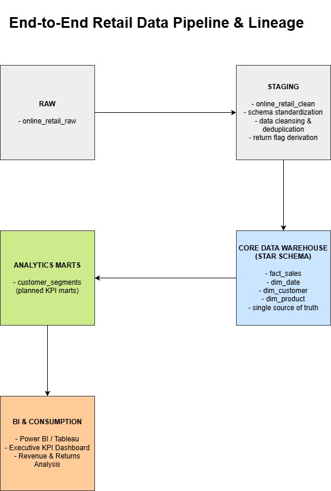
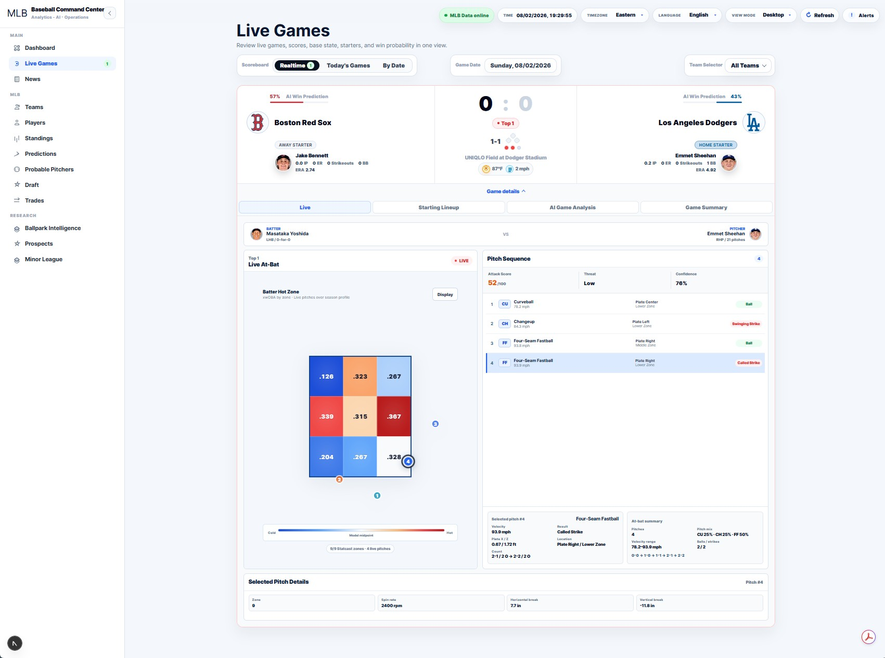

<h1>Hi, I'm Hyuntae Park 👋</h1>

  
  &nbsp;&nbsp;&nbsp;

  
  &nbsp;&nbsp;&nbsp;

  

 

  
  &nbsp;
  <strong>Rutgers University</strong>
  &nbsp;—&nbsp;
  M.S. Information Technology &amp; Analytics

   

  
  &nbsp;
  <strong>Baruch College</strong>
  &nbsp;—&nbsp;
  B.B.A. in Marketing Analytics

 

  📊 <strong>Data Analytics</strong>
  &nbsp;|&nbsp;
  🏗️ <strong>Data Engineering</strong>
  &nbsp;|&nbsp;
  🗄️ <strong>SQL &amp; Databases</strong>
  &nbsp;|&nbsp;
  🤖 <strong>Decision Intelligence &amp; AI</strong>

  I build data products that transform raw data into decision-ready intelligence —
   
  from data pipelines and SQL analytics to real-time applications, forecasting, and AI-powered insights.

## 🔧 Skills & Tools

### Programming & Analytics

   <strong>Python</strong>&nbsp;&nbsp;&nbsp;
   <strong>SQL</strong>&nbsp;&nbsp;&nbsp;
   <strong>R</strong>&nbsp;&nbsp;&nbsp;
   <strong>Pandas</strong>&nbsp;&nbsp;&nbsp;
   <strong>NumPy</strong>&nbsp;&nbsp;&nbsp;
   <strong>Scikit-learn</strong>

### AI & ML

   <strong>LLM / OpenAI</strong>&nbsp;&nbsp;&nbsp;
   <strong>PyTorch</strong>

### Data Engineering & Development

   <strong>PostgreSQL</strong>&nbsp;&nbsp;&nbsp;
   <strong>MySQL</strong>&nbsp;&nbsp;&nbsp;
   <strong>MariaDB</strong>&nbsp;&nbsp;&nbsp;
   <strong>FastAPI</strong>&nbsp;&nbsp;&nbsp;
   <strong>React</strong>&nbsp;&nbsp;&nbsp;
   <strong>Docker</strong>

### Cloud & BI

   <strong>AWS</strong>&nbsp;&nbsp;&nbsp;
   <strong>Render</strong>&nbsp;&nbsp;&nbsp;
   <strong>Linux</strong>&nbsp;&nbsp;&nbsp;
   <strong>Tableau</strong>&nbsp;&nbsp;&nbsp;
   <strong>Power BI</strong>&nbsp;&nbsp;&nbsp;
   <strong>Excel</strong>

### Enterprise & Development Tools

   <strong>SAP S/4HANA</strong>&nbsp;&nbsp;&nbsp;
   <strong>QuickBooks</strong>&nbsp;&nbsp;&nbsp;
   <strong>Git</strong>&nbsp;&nbsp;&nbsp;
   <strong>GitHub</strong>&nbsp;&nbsp;&nbsp;
   <strong>VS Code</strong>&nbsp;&nbsp;&nbsp;
   <strong>Jupyter</strong>

---

## 🚀 Featured Projects

### 🏬 End-to-End Retail Data Warehouse

  

An end-to-end retail data warehouse connecting raw operational data, ETL workflows, dimensional modeling, and business intelligence.

- Data ingestion, transformation, and validation
- Star schema and dimensional data modeling
- KPI development and analytics-ready data marts
- Revenue, customer, product, and operational analysis

**Tech:** Python · SQL · PostgreSQL · ETL · Dimensional Modeling

📁 **[Repository](https://github.com/hyuntaepark-gh/End-To-End-Retail-Data-Warehouse)**

---

### 🧠 AI Executive KPI Intelligence Micro-SaaS

An AI-powered analytics backend designed to transform business questions into structured KPI analysis and executive insights.

- SQL-driven KPI and business driver analysis
- Anomaly detection and risk identification
- AI-assisted executive reporting
- REST APIs, asynchronous jobs, and containerized infrastructure

**Tech:** Python · FastAPI · PostgreSQL · Docker · LLM Integration

📁 **[Repository](https://github.com/hyuntaepark-gh/AI-Executive-KPI-Intelligence-Micro-SaaS)**

---

### ⚾ Baseball Live Analytics

  

An MLB analytics web application integrating live game information, player and team statistics, and baseball intelligence.

- Live pitch-by-pitch game analytics
- Player and team performance insights
- Trade and transaction tracking
- API-driven data integration and interactive visualization

**Tech:** Python · FastAPI · PostgreSQL · React · REST APIs

🔴 **[Live Demo](https://baseball-live-analytics.onrender.com/)**

---

### 🔬 Advanced LLM Scientific Research System

A scientific literature research framework integrating information retrieval, retrieval-augmented generation, and evidence-grounded analysis.

- Lexical, semantic, and hybrid document retrieval
- BM25, TF-IDF, and retrieval ranking experiments
- Research-paper comparison and citation analysis
- Evidence verification and reproducible evaluation workflows

**Focus:** Python · RAG · Information Retrieval · LLM · Research Evaluation

📁 **[Repository](https://github.com/hyuntaepark-gh/Advanced-LLM-Scientific-Research-System)**

---

## 🧪 Applied Machine Learning & Research

| Project | Focus |
|---|---|
| [IDC Adversarial Robustness](https://github.com/hyuntaepark-gh/IDC-Adversarial-Robustness) | Deep learning, adversarial attacks, model robustness, explainable AI |
| [MLB Statcast Comprehensive Analytics](https://github.com/hyuntaepark-gh/MLB-Statcast-Comprehensive-Analytics) | Pitch-level analytics, statistical modeling, historical comparisons, predictive ML |
| [AI Warehouse Shipment Forecasting](https://github.com/hyuntaepark-gh/Ai-Warehouse-Shipment-Forecasting) | Time-series forecasting, operational analytics, decision support |
| [EPL Team Style & Match Prediction](https://github.com/hyuntaepark-gh/EPL-Team-Style-Analysis-Match-Prediction-System) | Unsupervised learning, clustering, PCA, match prediction |

---

## 📊 Business Analytics & Data Intelligence

| Project | Focus |
|---|---|
| [Olist SQL Analytics](https://github.com/hyuntaepark-gh/olist-sql-analytics) | Advanced SQL, revenue analysis, cohort retention, business KPIs |
| [Tableau Visualization Projects](https://github.com/hyuntaepark-gh/Tableau-Visualization-Projects) | Business intelligence, interactive dashboards, data storytelling |
| [SAP S/4HANA Labs](https://github.com/hyuntaepark-gh/SAP-S4HANA-Labs) | Enterprise systems, ERP processes, business operations |
| [AWS SQL Database Analytics](https://github.com/hyuntaepark-gh/AWS-SQL-Database-Analytics) | Relational databases, SQL analysis, database design |

---

## 📚 Additional Analytics Projects

- ✈️ [JFK Airport Flight Delay Analysis](https://github.com/hyuntaepark-gh/JFK-Airport-Flight-Delay-Analysis)
- ₿ [Bitcoin Price Regression Analysis](https://github.com/hyuntaepark-gh/Bitcoin-Price-Regression-Analysis)
- ⚾ [Moneyball Analysis](https://github.com/hyuntaepark-gh/Moneyball-Analysis)

---

## 🌐 Portfolio & Connect

Explore my complete portfolio, including project documentation and interactive applications.

🌐 **[Portfolio Website](https://hyuntaepark-gh.github.io/)** ·
💼 **[LinkedIn](https://www.linkedin.com/in/hyuntae-park-in)**
